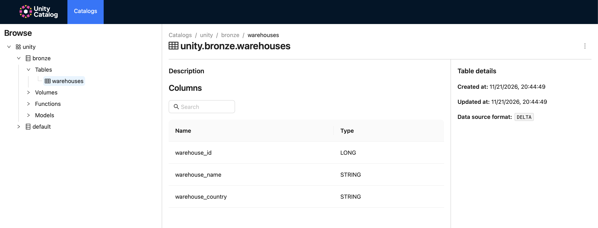

# Spark 4.2 by example: Hands-on overview of new features

### Introduction
The recent wave of Spark 4.2 coverage has done a great job introducing what is new, and it leaves room for a closer look at the practical side.
This is a gap that this post tries to cover. We will discover major new Spark 4.2 features with a focus on hands-on practice.

### Setup
First, let's outline a project setup that will serve as a foundation for further demos.

An example data project is a pipeline for an IoT system that tracks readings from a number of sensors across enterprise warehouses that belong to the same company, Abstract Warehouse Company (AWC).

The domain model is as follows:

- `warehouse` – a single warehouse.
- `section` – each warehouse is subdivided into a number of sections. `warehouse` has a one-to-many relationship with `section`.
- `sensor` – an installable IoT device. Sensors differ by type, including humidity and motion.
- `installation` – a `sensor` installation event in a particular `section`. `installation` has one-to-one relationships with `sensor` and `section`.
- `reading` – a single sensor reading value at a point in time. `sensor` has a one-to-many relationship with `reading`.

The schema tables represent the corresponding domain entities.

- `sensor` – a table describing sensor metadata. Properties: sensor_id (incremental), sensor_type (Enumeration: humidity, temperature, motion, smoke, etc.), manufacturer (string), measurement_unit (Enumeration: percentage, Celsius, boolean, etc.).
- `reading` – a table describing a sensor reading value at a point in time: reading_id (UUID), sensor_id (FK), timestamp (TIMESTAMP NTZ), value (measurement value, type variant for flexibility).
- `warehouse` – a table describing an enterprise warehouse. Properties: warehouse_id (incremental), warehouse_name (string), warehouse_country (ISO-3166 alpha-3 code).
- `section` – a table describing an enterprise warehouse section. Properties: section_id (incremental PK), warehouse_id (FK), index (alpha-numerical representation on a map, e.g., A1, B3).
- `installation` – a table describing a sensor installation in a warehouse. Properties: installation_id (incremental PK), section_id (FK), sensor_id (FK), installation_timestamp (TIMESTAMP NTZ), installation_removal (TIMESTAMP NTZ, optional).

### Spark: Metrics and Semantic Modeling
A metrics view is a new object type available in Spark 4.2. The main problem it solves is to bring the semantic layer closer to raw data to have it defined in a single place.
Let's consider an example for AWC.

In this theoretical use case, the company goes through a warehouse digitalisation process. Management wants visibility into the progress. A business metric called “Active Installations Coverage” was proposed to show the ratio of active installations to target installations. The target is one installation per section per sensor type, using the distinct types in the sensor inventory.

The same metric must be calculated at different levels of granularity for different management levels. C-suite management wants to see the picture across the entire company. Country and warehouse managers want the same metric at their respective levels.

The classical approach would be to define precise calculations for each use case. First, we create a view with every section and sensor-type combination, including targets with no active installation. An installation counts as active when its removal timestamp is null:
```sql
CREATE OR REPLACE VIEW installations_view AS
SELECT
    sec.section_id,
    sec.`index` AS section_index,
    types.sensor_type,
    w.warehouse_name,
    w.warehouse_country,
    installed.installation_id,
    installed.installation_removal
FROM section sec
CROSS JOIN (SELECT DISTINCT sensor_type FROM sensor) types
LEFT JOIN warehouse w ON w.warehouse_id = sec.warehouse_id
LEFT JOIN (
    SELECT i.installation_id, i.section_id, s.sensor_type, i.installation_removal
    FROM installation i
    JOIN sensor s ON s.sensor_id = i.sensor_id
) installed ON installed.section_id = sec.section_id
    AND installed.sensor_type = types.sensor_type
```

Having this in place, we can now proceed to the calculation at the most granular level, by warehouse, section, and sensor type, for warehouse managers:
```sql
WITH section_sensor_counts AS (
    SELECT
        warehouse_country,
        warehouse_name,
        section_index,
        sensor_type,
        COUNT(DISTINCT installation_id) FILTER (WHERE installation_removal IS NULL)
            AS total_active_installations,
        COUNT(DISTINCT section_id, sensor_type) AS total_target_installations
    FROM installations_view
    GROUP BY warehouse_country, warehouse_name, section_index, sensor_type
)
SELECT *, total_active_installations / total_target_installations AS active_installations_coverage
FROM section_sensor_counts
```

Great, the query now shows a result similar to the following:
```
+-----------------+--------------+-------------+-----------+--------------------------+--------------------------+-----------------------------+
|warehouse_country|warehouse_name|section_index|sensor_type|total_active_installations|total_target_installations|active_installations_coverage|
+-----------------+--------------+-------------+-----------+--------------------------+--------------------------+-----------------------------+
|              NLD| Rotterdam Hub|           A2|     motion|                         0|                         1|                          0.0|
|              FRA|Lyon Warehouse|           A2|      smoke|                         0|                         1|                          0.0|
|              DEU| Hamburg Depot|           A2|     motion|                         1|                         1|                          1.0|
|              FRA|Lyon Warehouse|           A3|     motion|                         0|                         1|                          0.0|
|              NLD| Rotterdam Hub|           C5|   humidity|                         0|                         1|                          0.0|
+-----------------+--------------+-------------+-----------+--------------------------+--------------------------+-----------------------------+
```

One requirement has been met, and there is one more to go. Now we need to calculate the same metrics at a different level of granularity, per warehouse for country managers:
```sql
WITH warehouse_counts AS (
    SELECT
        warehouse_country,
        warehouse_name,
        COUNT(DISTINCT installation_id) FILTER (WHERE installation_removal IS NULL)
            AS total_active_installations,
        COUNT(DISTINCT section_id, sensor_type) AS total_target_installations
    FROM installations_view
    GROUP BY warehouse_country, warehouse_name
)
SELECT *, total_active_installations / total_target_installations AS active_installations_coverage
FROM warehouse_counts
```

This produces a result similar to the following:
```
+-----------------+--------------+--------------------------+--------------------------+-----------------------------+
|warehouse_country|warehouse_name|total_active_installations|total_target_installations|active_installations_coverage|
+-----------------+--------------+--------------------------+--------------------------+-----------------------------+
|              USA| Dallas Center|                         2|                         8|                         0.25|
|              FRA|Lyon Warehouse|                         2|                        12|          0.16666666666666666|
|              NLD| Rotterdam Hub|                         2|                        12|          0.16666666666666666|
|              GBR|London Station|                         3|                        12|                         0.25|
|              DEU| Hamburg Depot|                         3|                        12|                         0.25|
+-----------------+--------------+--------------------------+--------------------------+-----------------------------+
```

Here you can already spot the issue. The calculations for `total_active_installations` and `total_target_installations` are duplicated.

A first attempt to reuse this logic in one place could be to create a view with pre-aggregated calculations:
```sql
CREATE OR REPLACE VIEW installations_aggregated_view AS
SELECT
    warehouse_country,
    warehouse_name,
    section_index,
    sensor_type,
    COUNT(DISTINCT installation_id) FILTER (WHERE installation_removal IS NULL)
        AS total_active_installations,
    COUNT(DISTINCT section_id, sensor_type) AS total_target_installations
FROM installations_view
GROUP BY warehouse_country, warehouse_name, section_index, sensor_type
```

We can then use it the following way:
```sql
SELECT
    warehouse_country,
    warehouse_name,
    SUM(total_active_installations) AS total_active_installations,
    SUM(total_target_installations) AS total_target_installations,
    SUM(total_active_installations) / SUM(total_target_installations) AS active_installations_coverage
FROM installations_aggregated_view
GROUP BY warehouse_country, warehouse_name
```

For this rollup, the pre-aggregated counts give the same result:
```
+-----------------+--------------+--------------------------+--------------------------+-----------------------------+
|warehouse_country|warehouse_name|total_active_installations|total_target_installations|active_installations_coverage|
+-----------------+--------------+--------------------------+--------------------------+-----------------------------+
|              USA| Dallas Center|                         2|                         8|                         0.25|
|              FRA|Lyon Warehouse|                         2|                        12|          0.16666666666666666|
|              NLD| Rotterdam Hub|                         2|                        12|          0.16666666666666666|
|              GBR|London Station|                         3|                        12|                         0.25|
|              DEU| Hamburg Depot|                         3|                        12|                         0.25|
+-----------------+--------------+--------------------------+--------------------------+-----------------------------+
```

Each installation and each target belongs to a single section and sensor-type group, so the counts can be summed across those groups. The pre-aggregated view fixes the dimensions in advance. A metric view defines the measures once and evaluates them at the grain of each query.

Unlike regular views, metrics views are declared with YAML, which separates the notions of metrics and dimensions.
```sql
CREATE OR REPLACE VIEW installations_metrics
WITH METRICS
LANGUAGE YAML
AS $$
version: 0.1

# source query, view or table name to get data from.
source: installations_view

# dimensions - used in `GROUP BY` and `SELECT` clauses
dimensions:
  - name: warehouse_country # alias
    expr: warehouse_country # source column or expression

  - name: warehouse_name
    expr: warehouse_name

  - name: section_index
    expr: section_index

  - name: sensor_type
    expr: sensor_type

# measures - used in `SELECT` clause, performs calculation over
measures:
  - name: total_active_installations
    expr: COUNT(DISTINCT installation_id) FILTER (WHERE installation_removal IS NULL)

  - name: total_target_installations
    expr: COUNT(DISTINCT section_id, sensor_type)
$$
```

We can then use the view to calculate the same metrics at the lowest levels of granularity:
```sql
SELECT
    warehouse_country,
    warehouse_name,
    section_index,
    sensor_type,
    MEASURE(total_active_installations) as total_active_installations,
    MEASURE(total_target_installations) as total_target_installations,
    MEASURE(total_active_installations) /  MEASURE(total_target_installations) as active_installations_coverage
FROM installations_metrics
GROUP BY ALL
```

This produces a result similar to the following:
```
+-----------------+--------------+-------------+-----------+--------------------------+--------------------------+-----------------------------+
|warehouse_country|warehouse_name|section_index|sensor_type|total_active_installations|total_target_installations|active_installations_coverage|
+-----------------+--------------+-------------+-----------+--------------------------+--------------------------+-----------------------------+
|              NLD| Rotterdam Hub|           A2|     motion|                         0|                         1|                          0.0|
|              FRA|Lyon Warehouse|           A2|      smoke|                         0|                         1|                          0.0|
|              DEU| Hamburg Depot|           A2|     motion|                         1|                         1|                          1.0|
|              FRA|Lyon Warehouse|           A3|     motion|                         0|                         1|                          0.0|
|              NLD| Rotterdam Hub|           C5|   humidity|                         0|                         1|                          0.0|
+-----------------+--------------+-------------+-----------+--------------------------+--------------------------+-----------------------------+
```

A metrics view brings the most value when the same metrics need to be recalculated at a different level of granularity. We can now do that pretty easily:
```sql
SELECT
    warehouse_country,
    warehouse_name,
    MEASURE(total_active_installations) AS total_active_installations,
    MEASURE(total_target_installations) AS total_target_installations,
    MEASURE(total_active_installations) / MEASURE(total_target_installations) AS active_installations_coverage
FROM installations_metrics
GROUP BY warehouse_country, warehouse_name
```

This produces the desired numbers:
```
+-----------------+--------------+--------------------------+--------------------------+-----------------------------+
|warehouse_country|warehouse_name|total_active_installations|total_target_installations|active_installations_coverage|
+-----------------+--------------+--------------------------+--------------------------+-----------------------------+
|              USA| Dallas Center|                         2|                         8|                         0.25|
|              FRA|Lyon Warehouse|                         2|                        12|          0.16666666666666666|
|              NLD| Rotterdam Hub|                         2|                        12|          0.16666666666666666|
|              GBR|London Station|                         3|                        12|                         0.25|
|              DEU| Hamburg Depot|                         3|                        12|                         0.25|
+-----------------+--------------+--------------------------+--------------------------+-----------------------------+
```

However, metrics views have some limitations that regular views lack.
They can't be queried directly. A plain `SELECT * FROM installations_metrics` results in an error, so the author has to explicitly specify dimensions, measures, and grouping.
Measures (`measures`) can't reuse other measures in their definitions.
In our particular case, it would be great to introduce a new measure, `active_installations_coverage`, like this:
```yaml
measures:
  - name: active_installations_coverage
    expr: ROUND(total_active_installations / total_target_installations, 2)
```

However, this is considered an invalid definition. The workaround is to repeat parts of the query.

Last but not least, `GROUP BY ROLLUP` and `GROUP BY GROUPING SETS` do not appear to be supported either.
```sql
SELECT
    warehouse_country,
    warehouse_name,
    sensor_type,
    MEASURE(total_active_installations) as total_active_installations,
    MEASURE(total_target_installations) as total_target_installations,
    MEASURE(total_active_installations) /  MEASURE(total_target_installations) as active_installations_coverage
FROM installations_metrics
GROUP BY ROLLUP (warehouse_country, warehouse_name, sensor_type)
ORDER BY warehouse_country, warehouse_name
```

and

```sql
SELECT
    warehouse_country,
    warehouse_name,
    MEASURE(total_active_installations) as total_active_installations,
    MEASURE(total_target_installations) as total_target_installations,
    MEASURE(total_active_installations) /  MEASURE(total_target_installations) as active_installations_coverage
FROM installations_metrics
GROUP BY GROUPING SETS ((warehouse_country), (warehouse_country, warehouse_name))
ORDER BY warehouse_country, warehouse_name
```

Both queries would fail in Spark version `4.2.0`.

#### References
More on metrics views and the semantic layer can be found here:

- <https://issues.apache.org/jira/browse/SPARK-60399> - Jira for Spark native documentation
- <https://github.com/apache/spark/pull/59386> - PR with Spark native documentation
- <https://docs.google.com/document/d/1xVTLijvDTJ90lZ_ujwzf9HvBJgWg0mY6cYM44Fcghl0/edit?tab=t.0#heading=h.5fdy0uyv19hp> - "SPIP: Metrics & semantic modeling in Spark" Google Doc
- <https://docs.databricks.com/aws/en/uc-semantics/metric-views/yaml-reference>
- <https://learn.microsoft.com/en-us/azure/databricks/sql/language-manual/sql-ref-syntax-ddl-create-view>
- <https://books.japila.pl/spark-sql-internals/metric-views/>
- <https://books.japila.pl/spark-sql-internals/sql/SparkSqlAstBuilder/#visitCacheTable>
- <https://medium.com/@cheegodchang/why-do-we-need-unity-catalog-metric-views-455ce259519e>

### Spark: Remote spark
Spark now allows connect to remove cluster dirrectly from local codebase, no more `spark-submit` needed for this purpose.
Additional buty of this approach is ability to dockerise entire spark setup. For instance we can easely run spark with OSS Unity Catalog version via docker compose:
```yaml
name: unitycatalog

services:
  # Don't change `server` name because it ui image expects this in runtime
  server:
    image: unitycatalog/unitycatalog:v0.7.0
    ports:
      - "8080:8080"
    volumes:
      - type: volume
        source: unitycatalog_data
        target: /opt/unitycatalog/etc/data
      - type: bind
        source: ./compose-uc-server.properties
        target: /home/unitycatalog/etc/conf/server.properties
    healthcheck:
      test: ["CMD", "curl", "-f", "http://localhost:8080"]
      interval: 10s
      timeout: 5s
      retries: 3
    networks:
      - local-bricks

  uc-ui:
    image: unitycatalog/unitycatalog-ui:main-aadc6fc
    ports:
      - "3000:3000"
    depends_on:
      - server
    networks:
      - local-bricks

  spark-server:
    image: apache/spark:4.2.0
    user: "0"
    ports:
      - "15002:15002"
      - "8081:8080"
      - "4040:4040"
    volumes:
      - type: volume
        source: unitycatalog_data
        target: /opt/unitycatalog/etc/data
    entrypoint:
      - /opt/spark/bin/spark-submit
      - --class
      - org.apache.spark.sql.connect.service.SparkConnectServer
      - --packages
      - "io.delta:delta-spark_2.13:4.4.1,io.unitycatalog:unitycatalog-spark_4.2_2.13:0.7.0"
      - --conf
      - spark.sql.extensions=io.delta.sql.DeltaSparkSessionExtension
      - --conf
      - spark.sql.catalog.spark_catalog=org.apache.spark.sql.delta.catalog.DeltaCatalog
      - --conf
      - spark.sql.catalog.unity=io.unitycatalog.spark.UCSingleCatalog
      - --conf
      - "spark.sql.catalog.unity.uri=http://server:8080"
      - --conf
      - spark.sql.catalog.unity.token=
      - --conf
      - spark.sql.catalog.production=io.unitycatalog.spark.UCSingleCatalog
      - --conf
      - "spark.sql.catalog.production.uri=http://server:8080"
      - --conf
      - spark.sql.catalog.production.auth.type=static
      - --conf
      - spark.sql.catalog.production.auth.token=not-used
      - --conf
      - "spark.driver.extraJavaOptions=-Divy.cache.dir=/tmp -Divy.home=/tmp"
    depends_on:
      - server
    networks:
      - local-bricks

networks:
  local-bricks:
    driver: bridge

volumes:
  unitycatalog_data:
```

`compose-uc-server.properties` should be the following:
```
## Experimental Feature Flags
# Enable MANAGED table (experimental feature)
# Default: false (disabled)
server.managed-table.enabled=true

# Set the UC storage root
storage-root.tables=/opt/unitycatalog/etc/data
```

After the setup is up and running it possible to simply connect the spark via host port and continue working with local code:
```python
from pyspark.sql import SparkSession

spark = (
        SparkSession.builder.remote("sc://localhost")
        .appName("SimpleApp")
        .getOrCreate()
    )
    try:
        spark.sql("CREATE SCHEMA IF NOT EXISTS unity.bronze")
        spark.sql(
            """
            CREATE TABLE IF NOT EXISTS unity.bronze.warehouses (
                warehouse_id BIGINT NOT NULL,
                warehouse_name STRING NOT NULL,
                warehouse_country STRING NOT NULL
            ) USING DELTA
            """
        )
    finally:
        spark.stop()
```
after which you can find create schema and table in the local unity catalog:


### Spark SQL: Vector scoring and top-K retrieval
Spark 4.2 ships new set of functions to work with vectors. The target use cases is to provide a native support for working with text emdeings.
Keeping our theme of warehouse IoT porject: for instance we have a sensors catalog table called `catalog` with sensors specification like following:
```
+-----------+-----------------+--------------------+--------------------+
|       name|             unit|         description|           embedding|
+-----------+-----------------+--------------------+--------------------+
|        CO2|              ppm|Measures carbon d...|[0.047913764, 0.0...|
|   Humidity|             % RH|Measures relative...|[0.050460868, 0.0...|
|     Motion|          boolean|Detects movement ...|[0.045085106, -0....|
|      Smoke|percent per meter|Detects airborne ...|[0.03694558, 0.04...|
|Temperature|               °C|Measures ambient ...|[0.009319099, 0.0...|
+-----------+-----------------+--------------------+--------------------+
```

and search queries are stored in separate table:
```
+-----------+--------------------+
|      query|           embedding|
+-----------+--------------------+
|fire sensor|[-0.02075623, 0.0...|
+-----------+--------------------+
```

With new set of functions we can search over embeding vectors natively: 
```sql
SELECT q.query, c.name, c.unit, c.description,
       'Cosine similarity' AS metric,
       vector_cosine_similarity(q.embedding, c.embedding) AS score
FROM sensors_query q
JOIN sensors_catalog c
EXACT NEAREST 1 BY SIMILARITY vector_cosine_similarity(q.embedding, c.embedding)
UNION ALL
SELECT q.query, c.name, c.unit, c.description,
       'Inner product' AS metric,
       vector_inner_product(q.embedding, c.embedding) AS score
FROM sensors_query q
JOIN sensors_catalog c
EXACT NEAREST 1 BY SIMILARITY vector_inner_product(q.embedding, c.embedding)
UNION ALL
SELECT q.query, c.name, c.unit, c.description,
       'Negated Euclidean distance' AS metric,
       -1 * vector_l2_distance(q.embedding, c.embedding) AS score
FROM sensors_query q
JOIN sensors_catalog c
EXACT NEAREST 1 BY SIMILARITY -1 * vector_l2_distance(q.embedding, c.embedding)
ORDER BY metric, score DESC, name
```

so seach search would produce result like the following:
```
query| name|             unit|         description|              metric|             score|
+-----------+-----+-----------------+--------------------+--------------------+------------------+
|fire sensor|Smoke|percent per meter|Detects airborne ...|   Cosine similarity|0.6595850586891174|
|fire sensor|Smoke|percent per meter|Detects airborne ...|       Inner product|0.6595850586891174|
|fire sensor|Smoke|percent per meter|Detects airborne ...|Negated Euclidean...|-0.825124204158783|
+-----------+-----+-----------------+--------------------+--------------------+------------------+
```

References:
- https://spark.apache.org/docs/latest/api/python/reference/pyspark.sql/api/pyspark.sql.DataFrame.nearestByJoin.html
- https://spark.apache.org/docs/latest/sql-ref-syntax-qry-select-join.html#parameters
- https://spark.apache.org/docs/latest/api/sql/vector-functions/

### Spark SQL: Geographical types
Spark 4.2 finally ships native support for `GEOMETRY` and `GEOGRAPHY` types along with corresponding support of ST_* family of functions to work with them.
This makes working with geo spatial data way easier with spark. Prior to this [Apache Sedona](https://sedona.apache.org/latest/) was the only major solution for geo spatial data analytics.
Originally they were developed as a part of [GeoParquet](https://geoparquet.org) initiative, later started to be supported natively by [parquet itself](https://parquet.apache.org/docs/file-format/types/geospatial/).

Continuing our project topic, we could enrich warehouse data with polygon territory like this:
```sql
CREATE TABLE warehouse_geography
USING PARQUET
AS
SELECT 1L AS id,
       'Rotterdam Warehouse' AS name,
       'Netherlands' AS country,
       ST_GeogFromWKB(X'01030000000100000005000000CDCCCCCCCCCC1140713D0AD7A3F049406FB9FAB149CE1140713D0AD7A3F049406FB9FAB149CE114020ED7F80B5F04940CDCCCCCCCCCC114020ED7F80B5F04940CDCCCCCCCCCC1140713D0AD7A3F04940') AS polygon
```
which creates a table with the following schema:
```
root
 |-- id: long (nullable = true)
 |-- name: string (nullable = true)
 |-- country: string (nullable = true)
 |-- polygon: geography(4326) (nullable = true)
```

and query correspongly after:
```sql
SELECT id, name, country, hex(ST_AsBinary(polygon)) AS polygon_wkb FROM warehouse_geography
```

result:
```
+---+-------------------+-----------+--------------------+
| id|               name|    country|         polygon_wkb|
+---+-------------------+-----------+--------------------+
|  1|Rotterdam Warehouse|Netherlands|01030000000100000...|
+---+-------------------+-----------+--------------------+
````

Although this support of geo-spatial data is quite poor at the moment, apart from storign the engine does not yet supports functions like [`st_distance`](https://docs.databricks.com/aws/en/pyspark/reference/functions/st_distance) which exists on Databricks. Without them its quite hard to perform actuall analytics work so far, yet this is important step in full geo data support.

References:
https://spark.apache.org/docs/4.2.0-preview4/sql-ref-geospatial-types.html
https://spark.apache.org/docs/latest/sql-ref-geospatial-types.html

### Spark SQL: Spark Declarative Pipelines and Auto CDC
TODO

### Spark SQL: Smaller yet important additions

time buckets
https://spark.apache.org/docs/latest/api/sql/datetime-functions/#time_bucket
https://spark.apache.org/docs/latest/api/python/reference/pyspark.sql/api/pyspark.sql.functions.time_bucket.html
`QUALIFY` support for select - filter results of window function
